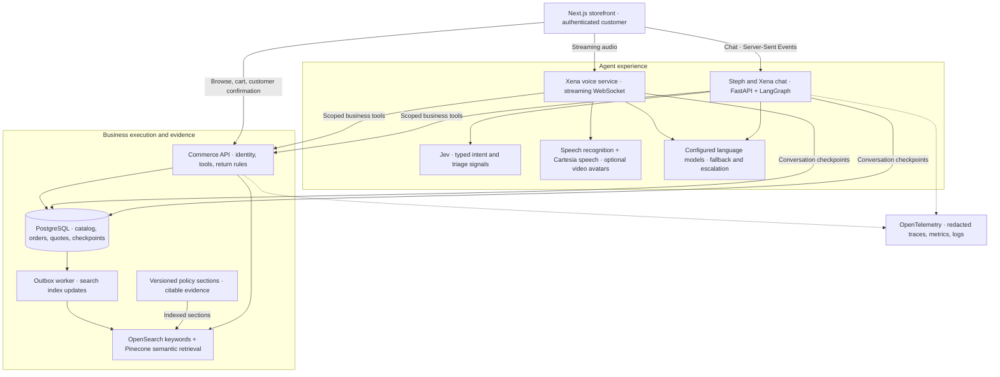
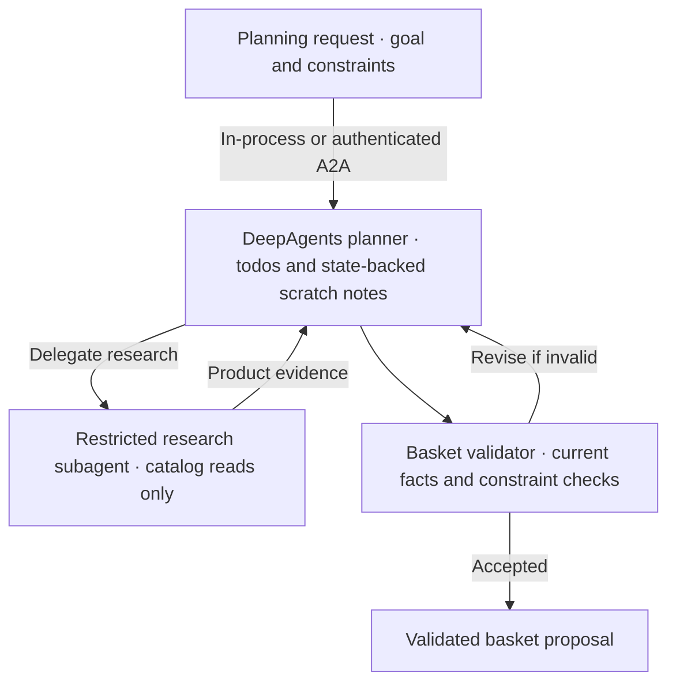

# Serigan Mart · Agentic AI Commerce

### Stateful AI agents for shopping, voice support, and customer-approved returns.


**Serigan Mart turns a complete shopping application into a practical agentic AI system:** agents retrieve product and policy evidence, call authenticated business tools, maintain conversation state, and pause for customer approval before a return is committed.

The experience combines **Steph**, a shopping assistant, with **Xena**, a voice and text support agent with optional video avatars. Behind the interface are LangGraph workflows, hybrid retrieval, streaming responses, deterministic refund calculations, and an evaluation suite covering product questions, orders, returns, and adversarial requests.

**Built by [Taro Serigano](https://taroserigano.com/)** · [Storefront walkthrough](demos/xena-15s-live/serigan-mart-walkthrough-40s.mp4) · [Voice and avatar demo](demos/xena-15s-live/xena-employer-demo-avatar.mp4) · [Evaluation methodology](evals/xana/README.md)

> Portfolio sandbox with seeded customers and orders. Payment processing and refund settlement are simulated until the Stripe integration is connected.

## Agentic AI at the core

| Capability | Engineering behind it |
|---|---|
| **Stateful tool-using agents** | LangGraph routes each turn through a model–tool loop, with PostgreSQL conversation checkpoints and separate tool permissions for shopping and support. |
| **Human-in-the-loop execution** | Return proposals interrupt the graph. The customer confirms through the authenticated browser; the agent resumes and checks the result. |
| **Grounded retrieval** | Retrieval-Augmented Generation (RAG) combines policy evidence and catalog facts with exact product filters. Citations must refer to sections actually retrieved. |
| **Streaming voice and video** | Xena combines speech recognition, a LangGraph voice brain, streamed speech, interruption handling, captions, and optional Tavus or HeyGen avatars. |
| **Controlled model escalation** | Code routes difficult voice turns—disputes, repeated questions, and repeated tool failures—to a stronger configured model. |
| **Evaluation and observability** | A 2,000-case development suite, additional support and held-out sets, deterministic checks, model judging, Ragas evaluation, and OpenTelemetry trace correlation. |
| **Advanced planning extensions** | Implemented DeepAgents planner, restricted research subagent, Agent-to-Agent (A2A) service, and resumable event-stream components; see their integration status below. |

## What the agents can do

### Steph · Shopping assistant

Ask for products in natural language, refine requirements across turns, inspect nutrition and ingredients, check orders, and add selected products to the cart.

**Example:** “Nonfat organic milk, not regular milk.”

Steph searches with product types, required tags, and exclusions, then returns product cards with current prices. Follow-up questions can narrow the selection without restarting the conversation.

### Xena · Voice, text, and avatar support

Ask about delivery, tracking, product specifications, return eligibility, or refund status. Xena retrieves the signed-in customer's records, explains the applicable policy, and prepares a return quote when appropriate.

The voice experience includes streamed speech, captions, customer interruptions, a configurable backup voice, and optional **Tavus / HeyGen LiveAvatar** video. Provider switching preserves the conversation and pending return context.

Xena can propose a return or open a support case. Her toolset does **not** include payment, refund settlement, cart modification, or return-confirmation tools.

## Architecture

The map below shows the main commerce, chat, and streaming voice paths. External integrations depend on the configured credentials and provider availability.



**Data authority matters:** search finds candidates; PostgreSQL supplies authoritative price, stock, order, and refund data. The language model explains and coordinates actions; business code calculates amounts and enforces eligibility.

### A return, from request to confirmation

1. **Identify:** retrieve the customer's order and clarify which item and quantity they mean.
2. **Validate:** the commerce service checks eligibility and calculates the refund from saved order amounts.
3. **Propose:** show a quote card; the LangGraph conversation pauses for the customer's decision.
4. **Confirm:** the browser obtains a quote-bound, single-use token and submits the customer's confirmation with an idempotency key. The token is kept out of model context.
5. **Resume:** the assistant checks the outcome with the commerce service and explains the next step.

Voice confirmation has an additional gate: the complete quote must be read back before a clear final confirmation can count. Provider-specific playback restrictions can require the on-screen confirmation button.

## DeepAgents and A2A extensions

The repository also contains a separate shopping planner for more complex goals, such as assembling a basket under a budget with dietary constraints.



- **Bounded autonomy:** model-call limits, tool-call limits, cancellation, and elapsed-time checks.
- **Restricted delegation:** the helper can research products but cannot write carts, inspect orders, or execute payments.
- **Code-enforced constraints:** budget, catalog allergen labels, and required or excluded tags are checked independently of the model. Parsed constraints can be tightened, not silently relaxed.
- **Authenticated A2A transport:** short-lived delegation tokens bind customer identity, audience, and scope, with a process-local replay guard.
- **Resumable streaming components:** typed Server-Sent Events (SSE), PostgreSQL event persistence, and reconnect/replay support.

These components are implemented in [services/planner](services/planner) and [packages/assistant-stream](packages/assistant-stream). They are extension components; the default development launcher currently starts the commerce, assistant, voice, outbox, and web services, rather than a fully connected planner gateway. A separate [Qdrant retrieval package](packages/retrieval) is also implemented; the current commerce search path uses OpenSearch and Pinecone.

## Reliability, permissions, and guardrails

| Boundary | Implementation |
|---|---|
| Customer isolation | Server-validated sessions and ownership checks for carts, orders, and conversations. |
| Agent identity | Scoped service identity acting for the authenticated customer; identity is injected by server code. |
| Financial correctness | Return quotes derive from saved order amounts, with tests covering cent rounding and partial returns. |
| Duplicate prevention | Quote validation, single-use confirmation tokens, and idempotent return creation. |
| Prompt injection | Restricted toolsets, untrusted-content handling, retrieved-section citation checks, and adversarial evaluation cases. |
| Provider failures | Configurable model fallbacks, a labeled scripted mode, speech-provider failover, and voice-to-text fallback behavior. |
| Trace privacy | Sensitive-attribute removal and text redaction in the application and OpenTelemetry Collector. |

## Evaluation: test the workflow, not just the wording

The evaluation suite checks what the customer receives: **product cards, order facts, citations, quote amounts, and permitted actions**.

| Layer | What it measures |
|---|---|
| 2,000 golden development cases | Product facts, filters, comparisons, orders, returns, noisy inputs, multi-turn conversations, and adversarial requests. |
| 204 support development cases | Account and store questions, shipping, catalog-wide queries, escalation, and broader support coverage. |
| 223 separate held-out cases | Additional templates, customers, and support scenarios, reported separately from the tuned development set. |
| Deterministic checks | Exact quote amounts, expected product constraints, order evidence, unauthorized claims, and citation provenance. |
| Language-model judge | Groundedness, helpfulness, clarity, tone, and disagreement with deterministic checks. |
| Ragas | Policy-answer faithfulness and answer relevance. |
| OpenTelemetry and LangSmith | Correlated evaluation traces and optional LangSmith experiment uploads for inspecting failures. |

**Historical results:** the October 8–9 evaluation notes report round-9 counts of **1,996/2,000 chat cases** and **1,985/2,000 voice-brain cases** passing. The separate 223-case set recorded **217 chat passes** and **213 voice passes** in that round.

These are recorded development results, not a claim about every deployment. The main suite was used for tuning, the separate set was evaluated across rounds, and voice-brain evaluations use typed turns rather than end-to-end microphone-to-audio testing. See [methodology, limitations, and run history](evals/xana/README.md).

## Full-stack product experience

- Multi-department catalog with product images, variants, nutrition, ingredients, allergens, ratings, and sample reviews.
- Search with filters, sorting, pagination, synonyms, and optional semantic retrieval.
- Persistent cart, seeded order history, and return/refund scenarios.
- Ten demo store locations around Dallas–Fort Worth, with maps, hours, services, and directions.
- Customer support conversations, support cases, and versioned return policies.
- Responsive Next.js interface with accessible labels, captions, and generated TypeScript API contracts.

## Technology stack

| Layer | Technologies |
|---|---|
| Agent orchestration | LangGraph, LangChain, PostgreSQL checkpoints; DeepAgents and A2A extension components |
| Model integration | Configurable OpenAI / Anthropic chat models; Jev intent and triage signals |
| Voice and avatars | Streaming WebSockets, OpenAI transcription, Cartesia speech, Tavus, HeyGen LiveAvatar |
| Backend | Python, FastAPI, Pydantic, SQLAlchemy, Alembic |
| Frontend | Next.js, React, TypeScript, Tailwind CSS, TanStack Query |
| Data and retrieval | PostgreSQL, OpenSearch, Pinecone; Qdrant in the separate retrieval package |
| Quality and observability | pytest, Playwright, Vitest, Ruff, mypy, TypeScript checks, Ragas, OpenTelemetry, Grafana, LangSmith evaluation export |

Jev and other external integrations require credentials. Missing integrations may use an explicitly labeled simulator or a documented fallback, depending on the component.

## Run locally

Requirements: **Node.js 20.9+**, **pnpm 10**, **uv**, and **PostgreSQL 16+** for the native-services setup. Docker/Podman is an alternative for the infrastructure stack. External model, speech, avatar, and semantic-search integrations need their corresponding credentials.

```bash
git clone https://github.com/taroserigano/ai-commerce-portfolio.git
cd ai-commerce-portfolio

cp .env.example .env
# Configure local service settings and the integrations you want to use.

pnpm local:up
pnpm bootstrap
pnpm dev
```

Open **http://localhost:3000**. Development account: `alice@example.com` / `alice-dev-password`. Seeded development accounts are limited to development, test, and continuous-integration environments.

For container-based infrastructure, use `pnpm infra:up` instead of `pnpm local:up`. Inspect [.env.example](.env.example) for configuration and [the build plan](docs/PLAN_ai-commerce-build.md) for milestone details.

### Checks and evaluation

```bash
pnpm lint
pnpm typecheck
pnpm test
pnpm test:e2e

pnpm eval:search
pnpm eval:planner
pnpm eval:jev
pnpm eval:xana
pnpm eval:xana:voice
```

Integration tests and browser tests require their supporting services. Live evaluations require the running application and configured providers and can incur API charges. Reseed demo orders before return evaluations so their dates remain current.

## Explore the implementation

| Path | Responsibility |
|---|---|
| [apps/web](apps/web) | Storefront, chat, voice/video experience, and customer confirmation interface |
| [services/assistant](services/assistant) | LangGraph chat workflows, business tools, policy retrieval, Jev signals |
| [services/voice](services/voice) | Streaming voice agent, model escalation, speech failover, avatar lifecycle |
| [services/commerce](services/commerce) | Authentication, catalog, cart, orders, returns, search, and outbox |
| [services/planner](services/planner) | DeepAgents basket planner, constrained helper, and authenticated A2A service |
| [packages/assistant-stream](packages/assistant-stream) | Typed streaming events, persistence, and reconnect/replay components |
| [packages/retrieval](packages/retrieval) | Qdrant retrieval extension and embedding/index contracts |
| [packages/telemetry](packages/telemetry) | Shared OpenTelemetry setup and redaction |
| [packages/contracts](packages/contracts) | Generated API schema and TypeScript client |
| [evals](evals) | Golden datasets, deterministic scoring, model judging, and evaluation export |
| [infra](infra) | Local services, telemetry collector, and Grafana dashboard configuration |

## Next enhancements

- Connect Stripe test checkout and refund settlement to the existing confirmation boundaries.
- Add Temporal-backed durable checkout and return orchestration.
- Complete storefront integration of the DeepAgents planner, authenticated A2A transport, and resumable stream components.
- Migrate the primary voice transport to LiveKit Agents while preserving the current tool and confirmation controls. HeyGen's LiveKit-based media integration is separate from this planned migration.
- Extend transport-level voice tracing beyond the timings and traces exported by the evaluation harness.
- Expand customer diversity and independently maintained evaluation sets, and publish fresh benchmark artifacts after catalog or model changes.
- Harden authentication and operational deployment before offering access beyond the development sandbox.

---

**Built to demonstrate end-to-end AI engineering: agent orchestration, grounded retrieval, streaming voice, business-system integration, explicit action boundaries, and measurable evaluation.**
