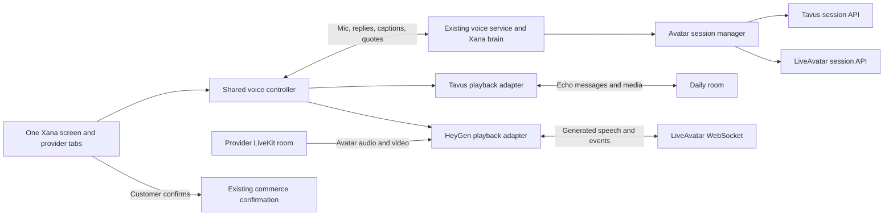

# 11. Xana: Tavus and HeyGen avatar tabs

Status: **implemented; connected LiveAvatar sandbox verified**, 2026-09-30.
Production presenter selection and cross-provider live acceptance remain.
See [SETUP.md](SETUP.md) and [IMPL.md](IMPL.md).

Request: keep Tavus for Xana and add a HeyGen avatar route, switchable by clicking a tab.

## Starting point

Build from the existing **`xana-avatar` worktree/branch**, inspected at commit `15f5dc1`:
`C:/Users/taro/Documents/TEMP/Walmart App/ai-commerce/.claude/worktrees/xana-avatar`.
The parent workspace's `milestone-1-signin-shopping` branch does not contain this integration.
The illustrated avatar and generated demo in the parent workspace are unrelated to this work.

The current implementation has:

- `/support/voice`, a persistent voice WebSocket, and a per-call Video toggle.
- `TavusFace` and `AvatarLink` in `services/voice/src/ai_commerce_voice/face_tavus.py`.
  The server creates/ends private Tavus conversations and sends session credentials to the
  signed-in browser. `VOICE_AVATAR=tavus` enables the configured provider.
- `use-xana-avatar.ts`, which joins Daily with microphone and camera publishing disabled.
- `avatar-echo.ts`, which forwards Xana's PCM audio to Tavus and estimates playback time.
- `use-voice-agent.ts`, which chooses local playback or avatar playback, drives captions,
  and reports completed speech to the voice service.
- `XanaAvatar`, which displays the returned video/audio stream.

Our STT, Xana brain/tools, Cartesia voice, conversation checkpoint, quote card, and commerce
confirmation endpoints already sit outside Tavus. Reuse them for both avatar providers.
Plan 10's implementation log still labels A2 as in progress: establish a passing Tavus
baseline before refactoring it; the presence of browser code is not evidence of a completed
live acceptance run.

## Customer experience and routes

Add a tab strip above the video stage:

```text
                       Meet Xana
                  [ Tavus ] [ HeyGen ]
                 [ active avatar video ]
                    captions / quote
                    Mute   Video off
```

| Route | Behavior |
|---|---|
| `/support/voice` | Existing entry point; selects Tavus by default. |
| `/support/voice/tavus` | Opens the voice screen with Tavus selected. |
| `/support/voice/heygen` | Opens the same screen with HeyGen selected. |

Use a shared `support/voice/layout.tsx` and a client shell that owns `useVoiceAgent` above
both provider pages. Read the selected route in that shell. Client navigation between tabs
must preserve the mounted controller, microphone, app WebSocket, conversation ID, captions,
and pending quote. Do not key the shell by provider or instantiate one call per tab.

Tab behavior:

1. Before a call, clicking a tab changes the selection and URL only. Start talking and the
   existing Video control remain explicit actions; loading a route creates no paid session.
2. During a voice call with video off, switching tabs selects the next video provider.
3. With video on, clicking the other tab interrupts the current output, shows
   `Switching to HeyGen…` or `Switching to Tavus…`, ends the old avatar, then joins the new one.
   There is a brief media gap; the app conversation stays open.
4. The tab choice, browser Back/Forward, and direct URLs use the same switching controller.
   A full reload starts a fresh media call through the existing conversation-resume behavior.
5. If the selected provider is unavailable, show the reason and keep voice available. Offer
   Retry and the other tab; do not start another provider automatically.
6. Preserve the microphone's prior mute setting. During the media handoff, pause input
   explicitly and show the switching state so a customer is not speaking into a discarded
   turn. Restore the prior state afterward, including on failure.

Use accessible tab semantics, a labelled panel, visible focus, and manual activation:
Left/Right/Home/End move focus; Enter/Space changes providers. Keyboard focus alone must
not start a session. Keep both labels visible on mobile. Provider tabs are temporarily
disabled while an already-submitted Confirm return request finishes; this prevents an
in-flight transaction UI from being torn down.

## HeyGen integration choice

Use **HeyGen LiveAvatar, Avatar Only (`mode: "LITE"`)**, with provider key `heygen` and
customer-facing label `HeyGen`. LITE accepts external audio and renders synchronized avatar
media, fitting the existing Xana pipeline. This is the current documented integration path.
See [LITE overview](https://docs.liveavatar.com/docs/lite-mode/overview).

The voice service creates the session; the browser joins its provider-managed LiveKit room
using `livekit-client` and forwards generated speech to the session WebSocket. This does
not require migrating Xana's microphone transport to LiveKit or exposing a local LiveKit
server to the internet. The provider can provision the media room itself.
See [configuration](https://docs.liveavatar.com/docs/lite-mode/configuration).

Do not build a second autonomous assistant in HeyGen. Both tabs use the same STT, prompts,
LLM/tool calls, Cartesia voice, citations, and return logic. The face will be a separately
configured LiveAvatar asset; a Tavus face ID cannot identify a HeyGen avatar. Start with an
available business-attired stock presenter consistent with Xana's existing visual brief.
Record the selected avatar ID and a preview before enabling it by default for testing.

The existing `@daily-co/daily-js` remains the Tavus transport. Add and pin `livekit-client`
for the HeyGen receiving connection. Server-owned session creation and an explicit audio
adapter fit this app; verify the selected client version during H0.



Only the selected adapter runs. The customer's microphone stays on our voice connection;
neither avatar room publishes a microphone or camera track. The provider notice names the
active service and explains that Xana's replies are sent there. Replies can contain order
details, so do not describe the outbound audio as containing no personal information.

## Server and protocol changes

Extract session orchestration from `face_tavus.py` into `avatar_session.py`. Keep Tavus's
API-specific behavior in its existing module; add `face_heygen.py` implementing the same
open/close boundary. Store provider session ID, credentials, creation time, and cleanup state
in a typed provider-specific session record.

Add a provider registry to `app.py` and configuration for:

| Setting | Proposed behavior |
|---|---|
| `VOICE_AVATAR_PROVIDERS` | Explicit enabled list, e.g. `tavus,heygen`; empty disables video. |
| `VOICE_AVATAR_DEFAULT` | `tavus` initially; used by the base route and legacy clients. |
| Existing `VOICE_AVATAR` | Compatibility fallback only when the new enabled list is absent. |
| `LIVEAVATAR_API_KEY` | Server secret for the LiveAvatar account. |
| `LIVEAVATAR_AVATAR_ID` | Avatar selected from that account's supported catalog. |
| `LIVEAVATAR_MAX_LIVE` | Per-process concurrency limit, initially 1 for integration work. |
| `LIVEAVATAR_MAX_SESSION_S` | Bound by the voice-call limit and account limit. |
| `LIVEAVATAR_SANDBOX` | Explicit development/test option; never silently retry as billable. |

Keep Tavus's existing settings. Check configuration without contacting a billable provider.
Expose per-provider availability and notices in `ready.avatar`; unknown/disabled providers
are rejected on the server even if the browser sends a handcrafted message.

Proposed wire changes (names can be finalized in H1):

```ts
type AvatarProvider = "tavus" | "heygen";

// Client intent; selecting null turns video off.
{ type: "avatar.select", provider: AvatarProvider | null, request_id: string }

// Server outcomes share correlation fields.
{ type: "avatar.switching", provider, request_id, generation }
{ type: "avatar", provider, request_id, generation, connection: /* tagged payload */ }
{ type: "avatar.ended", provider, request_id, generation }
{ type: "avatar.unavailable", provider, request_id, generation, reason }
```

Use a discriminated connection payload: Tavus gets its Daily URL/meeting token; HeyGen
gets `session_id`, `livekit_url`, `livekit_client_token`, and session-scoped `ws_url`.
Keep the account API key, API session token, and `livekit_agent_token` on the server.
Never log connection credentials, put them in navigation URLs, or persist them in browser
storage. Bind every session operation to the authenticated voice call's owner.

HeyGen lifecycle, checked against the official
[OpenAPI schema](https://docs.liveavatar.com/openapi.json):

1. `POST /v1/sessions/token` with the API key, `mode: "LITE"`, avatar ID, and duration limit.
2. `POST /v1/sessions/start` with the returned session bearer token.
3. Validate the returned session-scoped room and WebSocket fields before offering video.
4. `POST /v1/sessions/stop` for that session on video off, provider switch, disconnect,
   startup failure, timeout, and shutdown. Cleanup is idempotent with bounded retry.

Reserve provider capacity before startup. If a start completes after the customer switches
or closes the page, immediately end that stale session. Keep unresolved stop operations
tracked until confirmed or expired; do not release their capacity as if cleanup succeeded.
Use provider duration limits as a crash backstop.

## Switching lifecycle

Maintain separate `desiredProvider`, `activeProvider`, and a monotonically increasing
generation. Serialize the handoff on the server; coalesce rapid clicks to the latest intent.
Tag asynchronous joins, media callbacks, stop events, and playback reports with generation.

```text
active Tavus
  -> pause input and invalidate old output generation
  -> cancel/drop in-flight output; interrupt and detach old media
  -> leave Daily and end the Tavus session
  -> confirm old session ended
  -> create/join HeyGen and wait for usable audio/video plus control readiness
  -> restore input; replay a pending quote read-back if needed
  -> active HeyGen
```

The reverse switch follows the same flow. No simultaneous paid avatar sessions for a call.
If ending the old session cannot be confirmed, fall back to local voice while cleanup
retries; do not start another paid avatar in the uncertain state. A hang-up supersedes every
queued selection. Late callbacks from a retired generation cannot change the active UI.

Provider startup should run in cancellable tasks rather than blocking the microphone
WebSocket receive loop. A page departure, tab-close socket disconnect, and call shutdown
all run server cleanup; browser unload callbacks alone are insufficient.

## Browser adapters and playback

Give the shared controller one playback interface: join, accept segment/audio, end turn,
interrupt, query playback progress, leave, and emit ready/failed/completed events.

- Tavus adapter wraps the current Daily hook and `AvatarEcho`; preserve its measured
  turn grouping and duplicate-event handling behind that adapter.
- HeyGen adapter joins LiveKit without publishing local tracks, attaches the avatar's
  audio/video only, and opens one control WebSocket for its session. Readiness requires
  actual media and successful playback; handle autoplay rejection with an explicit action.
- Once an adapter owns a speech segment, local playback is suppressed for that segment.
  A failed or interrupted segment is not replayed halfway through another output path.
  Subsequent output can use local voice after an explicit fallback transition.

LiveAvatar's [event contract](https://docs.liveavatar.com/docs/lite-mode/events) uses
`agent.speak` for PCM16 mono at 24 kHz, `agent.speak_end` to seal an utterance, and
`agent.interrupt` to clear it. Wait for `session.state_updated: connected` before commands.
Map our utterance IDs to `source_event_id`; ignore duplicate and stale events. Only
`agent.speak_ended` is an end-of-speech candidate. Buffer append/commit acknowledgements
cannot establish that someone heard speech.

Bound pending audio and inspect socket backpressure. The provider recommends roughly
one-second chunks; H0 compares that with smaller chunks using actual speech. Do not copy
Tavus's 100 ms chunk setting without measuring. Send keepalive only while a call owns the
session, and stop heartbeat timers on all exits.

## Return read-back correctness: prerequisite

Code review found a relevant existing issue: `VoiceSession._barge_in()` sets unfinished
segments' `complete=True`, while `_on_final()` checks that same field to decide whether a
return read-back was heard. Tab switching must not reuse this cancellation path unchanged.
This is a code-review finding; no live return was attempted during planning.

Before enabling switching, separate output lifecycle from confirmation evidence:

- A segment can be finished/cancelled for scheduling while `heard_complete` remains false.
- Tag segments and playback reports with an output generation, including local playback.
  Reject old-generation, unknown, dropped, and interrupted completion reports server-side.
- A pending quote survives a switch, but its spoken-confirmation readiness is cleared.
  Replay its exact server-owned read-back in the new output generation, without making a
  new quote or rerunning return tools. Revalidate expiry first. Keep the Confirm return
  button available under its existing commerce checks.
- Advancing captions can use estimated audible time. Allowing a spoken yes requires a
  matching clean end event, complete segment delivery, active media playback, and the
  verified playout timing for that provider. A timeout cannot mark a read-back heard.
- H0 must measure how `agent.speak_ended` relates to audible completion. If that cannot be
  established reliably, ship HeyGen with button confirmation and an explicit UI cue until
  its spoken-confirmation gate is proven.

The provider cannot confirm or refund anything. The existing browser-owned, quote-bound,
idempotent commerce confirmation remains authoritative. Tab clicks never call it.

## Implementation sequence

| Phase | Work | Completion evidence |
|---|---|---|
| H0: baseline and provider spike | Run the current Tavus tests; confirm its browser path. Validate LiveAvatar LITE token/start/stop, browser WebSocket connectivity, media token scope, chunk sizes, readiness, interrupt, and audible completion. | A recorded provider contract and latency measurements; all created sessions ended. |
| H1: session and playback contracts | Provider registry, tagged connections, serialized switch generation, capacity cleanup, and distinct cancelled/heard states. Adapt Tavus to the boundary. | Existing Tavus tests pass; lifecycle races and read-back cancellation cases pass. |
| H2: HeyGen adapter | Server API adapter, browser LiveKit/control socket adapter, bounded audio buffering, event correlation, captions, and local-voice fallback. | A grounded Xana answer plays through HeyGen with synchronized video and one audible stream. |
| H3: provider routes and tabs | Persistent layout/controller, both routes, accessible tabs, Back/Forward handling, switching and unavailable states, provider notices. | Switching either direction preserves conversation and quote; no second app voice connection. |
| H4: acceptance | Integration/E2E coverage, bounded live calls, mobile smoke check, settings/setup docs and updated provider measurements. | All functional and lifecycle criteria below pass; any spoken-confirmation limitation is documented. |

## Expected file changes

Paths below are relative to the `xana-avatar` worktree.

| Area | Files |
|---|---|
| Provider sessions | `services/voice/src/ai_commerce_voice/{avatar_session.py,face_heygen.py,face_tavus.py,app.py,config.py}` |
| Read-back state | `services/voice/src/ai_commerce_voice/session.py` and existing session tests |
| Wire contract | `apps/web/lib/voice-protocol.ts` |
| Browser output | `apps/web/lib/use-voice-agent.ts`, `use-xana-avatar.ts`, `avatar-echo.ts`; new provider adapter modules and HeyGen playback timeline |
| Routes and tabs | `apps/web/app/(voice)/support/voice/{layout.tsx,page.tsx,[provider]/page.tsx}`; shared client shell and provider tabs under `components/voice/` |
| Stage | `apps/web/components/voice/{xana-voice-screen.tsx,xana-avatar.tsx}` |
| Configuration | `.env.example`, `scripts/dev.mjs` voice-child secret loading, `apps/web/package.json`, lockfile, setup documentation |
| Verification | Voice provider/lifecycle/session unit tests, browser adapter tests, `tests/e2e/specs/xana-avatar-providers.spec.ts`, opt-in live HeyGen test |

## Acceptance checks

1. Both routes require sign-in and select the matching tab. Invalid provider slugs return
   404. Route load and pre-call tab clicks make no avatar API calls.
2. Tavus and HeyGen each render real provider video driven by the same Xana speech.
   The microphone/camera publish count to either avatar service is zero.
3. Switching while idle, listening, generating, speaking, and starting the provider preserves
   the app conversation. Rapid clicks, Back/Forward, and late joins select only the latest
   requested provider; obsolete sessions are ended.
4. A switch, interruption, playback failure, duplicate completion, or delayed old-provider
   completion never makes an unheard read-back eligible for voice confirmation.
5. Switching with a pending quote retains its ID/card, resets spoken readiness, and replays
   or clearly offers button confirmation. No return is created by switching.
6. Video off, hang-up, WebSocket loss, session expiry, navigation away, and failed startup
   release media resources, timers, and provider sessions. Test failed stops and retries.
7. There is one audible speech source. Autoplay denial, exhausted capacity, missing config,
   provider failure, and slow first video give an understandable state and working voice.
8. Tokens stay scoped to the signed-in call and out of logs/URLs. Concurrency limits hold
   under parallel starts. Browser transport tests explicitly assert no track publication.
9. Compare provider startup time, speech-to-audible delay, switch gap, and interruption
   time. Plan 10 measured Tavus's added speech delay at about 0.8 s; measure HeyGen rather
   than assuming vendor latency claims. Choose timeouts from those observations.

Run focused unit/integration tests, web typecheck/lint, and E2E tests for routes and provider
switching. Live tests are opt-in, bounded, and always clean up in `finally`; use synthetic
orders/speech. The documented sandbox has one test avatar and roughly one-minute sessions;
verify LITE access for the configured account before relying on it. A sandbox check does not
validate the final selected avatar. See [sandbox documentation](https://docs.liveavatar.com/docs/sandbox-mode).

## Inputs for the connected run

Implementation can begin with isolated provider fixtures. A connected HeyGen test needs a
**LiveAvatar API key**, an accessible avatar ID, and account access to LITE sessions.
The precise production avatar remains a configuration choice.

Credential follow-up, 2026-09-30: Taro added `HEYGEN_APIKEY` in the parent workspace's root
`.env`. Only the variable name/presence and HTTP status were reported; the value was not
printed or written into this plan. Read-only checks returned:

| Check | Result |
|---|---|
| HeyGen `GET https://api.heygen.com/v2/avatars` | HTTP 200: the supplied key works for HeyGen. |
| LiveAvatar `GET https://api.liveavatar.com/v1/avatars` | HTTP 401: the supplied key was rejected by LiveAvatar. |
| `xana-avatar/.env` | No HeyGen or LiveAvatar key currently present. |

Set a key from [LiveAvatar's developer settings](https://app.liveavatar.com/developers)
as `LIVEAVATAR_API_KEY` in the parent root `.env`. Keep `HEYGEN_APIKEY` for the HeyGen API.
HeyGen documents LiveAvatar as a separate platform with its own plans and settings:
[LiveAvatar FAQ](https://help.heygen.com/en/articles/12758866-liveavatar-faq).

The current `VoiceSettings` resolves `.env` relative to its own checkout, so it will not
automatically read a new parent-root entry. In H1, add an explicit optional shared-secrets
file input to the development voice launcher. Read only allowlisted avatar secrets from
that file into the **voice child process**; process environment and worktree-specific values
take precedence. Point that input at the parent root `.env` for this development worktree.
Keep worktree database/port configuration local and never forward provider secrets to the
web child process. After integration into the parent checkout, its ordinary root `.env`
path already applies.

The checks above created no provider sessions. LITE session access and the final avatar
remain H0 validation work; a successful HeyGen catalog request cannot establish either.

## References checked on 2026-09-30

- Existing [Tavus plan](../10-xana-avatar/PLAN.md) and [implementation log](../10-xana-avatar/IMPL.md).
- [LiveAvatar LITE lifecycle](https://docs.liveavatar.com/docs/lite-mode/lifecycle).
- [LITE configuration](https://docs.liveavatar.com/docs/lite-mode/configuration) and
  [events](https://docs.liveavatar.com/docs/lite-mode/events).
- [Create session token](https://docs.liveavatar.com/api-reference/sessions/create-session-token),
  [start](https://docs.liveavatar.com/api-reference/sessions/start-session),
  [stop](https://docs.liveavatar.com/api-reference/sessions/stop-session), and
  [OpenAPI](https://docs.liveavatar.com/openapi.json). The schema exposes the LITE variant
  and start response fields more clearly than the API pages' default FULL examples.
